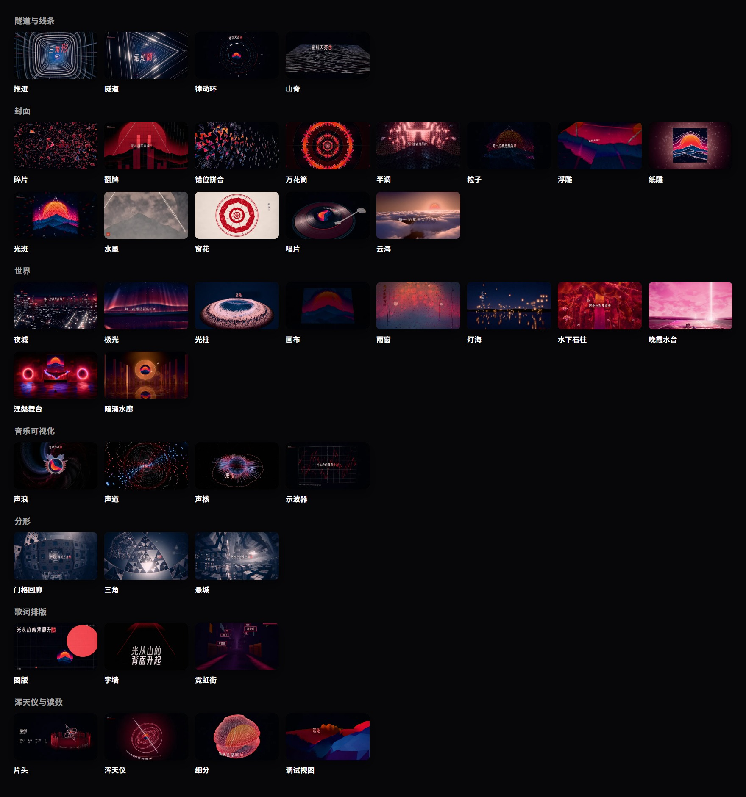
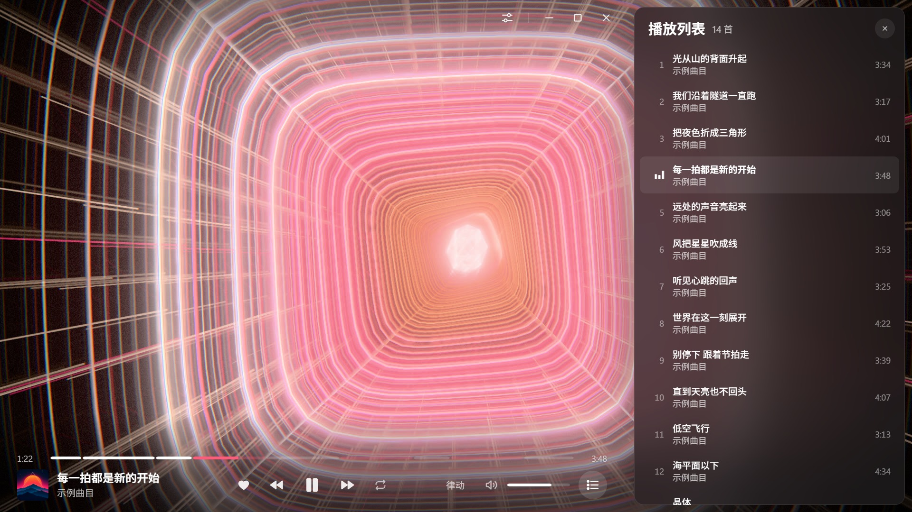
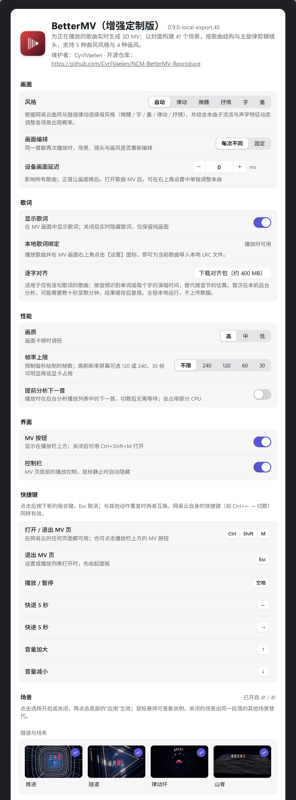

<div align="center">


# BetterMV（增强定制版）

**为网易云音乐中的每一首歌，实时生成专属 3D MV。**

播放歌曲后，点击播放栏上方的 MV（或按 `Ctrl+Shift+M`）。BetterMV 先分析整首歌曲的节拍、段落与主旋律声部，<br>
再以专辑封面构建 3D 场景、按乐句结构剪辑镜头，全部在本机通过 WebGL 2 实时渲染生成。

[直接下载最新安装包 (.plugin)](https://github.com/CyrilVaelen/NCM-BetterMV-Reproduce/releases/download/latest/ncm-better-mv.plugin) | [Releases 版本页](https://github.com/CyrilVaelen/NCM-BetterMV-Reproduce/releases/latest) | [定制演进记录](STATUS.md) | [历史更新](CHANGELOG.md) | [问题反馈](https://github.com/CyrilVaelen/NCM-BetterMV-Reproduce/issues)

</div>

> **版本说明**：本仓库为 [**CyrilVaelen**](https://github.com/CyrilVaelen) 基于开源插件 BetterMV 进行多轮深度重构、场景扩充与管线提速的个人改进版本（当前版本 `0.9.0-local-export.43`）。推送代码后由 GitHub Actions 自动编译并实时更新至本仓库 [Releases 最新版](https://github.com/CyrilVaelen/NCM-BetterMV-Reproduce/releases/latest)。

## 核心功能与定制增强

- **曲式段落与主旋律声部解析**：自动识别 BPM、拍号、底鼓/军鼓冲击，以及前奏、主歌、铺垫（Build）、副歌（Chorus）、Drop、尾奏等段落，并从混合音频中估计持续主旋律（Lead、电钢琴、复音和弦）驱动全部 41 个场景的主体动效；针对电子乐 / Melodic Dubstep 重构 Build → Drop 能量包络回扫、连续 Drop 区分与无黑闪入拍叠化转场。
- **以专辑封面驱动视觉**：全部场景的色彩体系、冷暖光影与明暗构图实时取自当前播放歌曲封面（例如涅槃舞台的双 Lead 代表色系统可随双路旋律与人声动态流动融合），黑白封面自动生成黑白影调 MV。
- **5 种曲风导演风格**：快歌与电子为 **“律动”**，Deep House / 午夜暗调律动为 **“微醺”**（丝滑长镜头与柔和叠化转场），慢歌为 **“抒情”**，说唱为 **“字”**，国风为 **“墨”**。支持根据曲风标签与声学特征自动选择，也可手动固定。
- **三维立体歌词与本地 LRC 配对**：歌词作为立体元素立于三维场景中，随演唱逐词亮起并附带译文；新增**一键隐藏歌词（纯画面模式）**、**单曲独立歌词/画面延迟微调**、**本地 LRC 文件绑定与同名本地音频配对分析**，以及跨句声学边界收敛防重影。
- **每次播放都不同 + 4 种后期画风**：场景顺序、机位与后期画风支持每次随机编排或固定种子；部分段落可实时重绘为 **孔版印刷（Riso 专色套印）**、**像素（Hi-bit 点阵屏）**、**字符画（曲面 CRT 歌词字符映射）** 或 **录像带（VHS 磁头撕裂与色度拖影）**。
- **专属浑天仪**：每首歌按其段落、拍号与鼓点生成独有的机械浑天仪，在开场、首次 Drop 前环绕推入，并在结尾依次合拢。
- **秒开秒切管线提速**：内置音频分析结果磁盘缓存、常驻 WebGL 着色器保活池、全场景静态着色器重构与 D3D11 编译加速、场景懒实例化与前瞻渐进预热，大幅压缩首次打开与切歌等待时间。
- **本地高帧率视频导出**：内置本地渲染导出工具链（`exporter/`），支持将生成的 MV 渲染导出为 `720p` / `1080p`（`24` / `30` / `60` fps）高清 MP4 视频。

## 41 个实时 3D 动效场景（7 大分组）

<p align="center"></p>

<p align="center"><b>41 个实时 3D 场景</b>，按设置页从上至下依次分为<b>隧道与线条（4）、封面（13）、世界（10）、音乐可视化（4）、分形（3）、歌词排版（3）、浑天仪与读数（4）</b>七组</p>

1. **隧道与线条（4 个）**：**推进**（高潮冲刺隧道与扩散冲击环）、**隧道**（节拍线框穿梭冲入封面）、**律动环**（分频同心表盘与外圈音序器）、**山脊**（封面明暗/宣纸水墨远山扫光）。
2. **封面（13 个）**：**碎片**（三角封面墙声波凸起、副歌翻转、Drop 碎裂穿行）、**翻牌**（翻牌波与频谱均衡器）、**错位拼合**（多深度碎片特定机位拼回封面）、**万花筒**（6–12 瓣折叠旋转频谱）、**半调**（网点随频谱伸缩、军鼓错版）、**粒子**（三万光点起伏散落）、**浮雕**（声音预演柱阵贴地掠飞）、**纸雕**（多层背光剪影）、**光斑**（副歌拉焦散景）、**水墨**（宣纸卷轴竖排歌词）、**窗花**（红纸剪纸旋转生长）、**唱片**（声纹音轨与环绕歌词）、**云海**（落日染云/水墨朱红落日）。
3. **世界（10 个，含 4 个新增大型定制场景）**
   - **夜城 / 极光 / 光柱 / 画布 / 雨窗 / 灯海**：楼群灯海随鼓点成片涌亮与副歌光环扫城、冰湖极光褶皱流光、频谱圆盘针阵与升温光环、人声笔压绘出封面（国风为宣纸水墨）、起雾雨窗指尖写词滑落水珠、夜湖逐字升起孔明灯。
   - **水下石柱（新增）**：沉入与封面同色调的深海秘境、自然岩崖拱门与海底巨石柱群，底鼓激起地脉光纹，主导音色点亮符文能量槽，发光水母与晶莹气泡漂浮喷涌，进入 Drop 首帧破水下潜。
   - **晚霞水台（新增）**：下方 3D 全透水质平台平放专辑封面并随主旋律荡开层层波纹，上方同色调梦幻晚霞、流云与炽白夕阳随 Drop 律动调节夕阳光圈与光柱亮度。
   - **涅槃舞台（新增）**：两侧巨型立体发光圆环音响随 Drop 震颤激荡声波；中央呈现完整专辑封面，高空写实火凤凰振翅盘旋，全身烈焰与双 Lead 代表色随主旋律与人声起伏融合爆发，湿润舞台地面实时水波反射。
   - **暗涌水廊（新增）**：都市午夜暗调玻璃水廊与薄水玄武岩倒影，中央悬浮嵌有封面的琥珀黑胶，廊顶暖雾随四四拍执行侧链抽吸呼吸，两侧十二片磨砂玻璃光栅与远景立体摩天楼群随和弦、主旋律泛起流光与信标闪烁，反拍开镲点亮水面焦散。
4. **音乐可视化（4 个）**：**声浪**（旋臂频谱与扩散冲击波）、**声道**（未来频谱光管飞行，Drop 收紧加速）、**声核**（数千分频光刺球体与双声道波形环）、**示波器**（实时波形与左右声道 X-Y 矢量图形）。
5. **分形（3 个）**：**门格回廊**（门格海绵穿梭）、**三角**（谢尔宾斯基四面体穿窗）、**悬城**（康托尘悬浮方块群穿缝飞行）。
6. **歌词排版（3 个）**：**图版**（瑞士网格海报大字排版）、**字墙**（说唱逐行堆叠字墙与高亮词）、**霓虹街**（雨夜窄街霓虹招牌逐字点亮与湿地倒影）。
7. **浑天仪与读数（4 个）**：**片头**（整曲响度光柱圈与 BPM/拍号读数）、**浑天仪**（定制机械环咬合旋转）、**细分**（多面体半拍频谱细分球）、**调试视图**（低多边形声波地形每拍切换线框/法线/深度）。

> 上图所有场景预览均使用统一的示例封面与示例歌词实机渲染，实际播放时实时取用当前歌曲的专辑封面与歌词。

## MV 页与播放控制

<p align="center"></p>
<p align="center">MV 全屏页实拍：底部分段进度控制栏（高潮段落高亮标记）与右侧滑出播放列表抽屉</p>

MV 页底部为播放控制（喜欢、切歌、播放模式、分段进度条、音量、播放列表），进度条按识别出的歌曲段落分格并对高能量段落着色，悬停显示段落名称与时间；右上角提供设置抽屉、最小化、最大化和退出按钮，鼠标静止时控制栏自动隐藏。

默认快捷键（均可在设置中自定义）：`空格` 播放/暂停，`←` `→` 快退/快进，`↑` `↓` 调节音量，`Esc` 退出，`Ctrl+Shift+M` 打开/关闭 MV；网易云自身的全局/切歌快捷键（如 `Ctrl+←` / `Ctrl+→`）同样有效。

## 设置项说明

<p align="center"></p>
<p align="center">BetterNCM 深色主题下的插件设置页（含 5 种风格选择、歌词显示/本地 LRC 绑定与 41/41 场景开关）</p>

- **风格**：自动，或手动指定为 `律动`、`微醺`、`抒情`、`字`、`墨`。
- **显示歌词**：开启或关闭场景中的三维歌词显示；关闭后实时隐藏所有歌词，方便纯画面欣赏或录屏。
- **画面编排**：同一首歌每次播放重新编排场景与镜头，或固定为同一种；在 MV 页右侧设置抽屉中可随时点击“换一种”。
- **画质与帧率上限**：画质可选高、中、低；帧率上限支持不限、`240`、`120`、`60` 或 `30` fps。
- **提前分析下一首 & 磁盘缓存**：后台预分析下一首歌曲并将分析结果缓存至本地磁盘，二次播放与切歌即点即开。
- **延迟与本地歌词导入**：支持调节全局蓝牙画面延迟（ms）、单曲画面延迟、单曲歌词延迟，以及为特定歌曲导入本地 `.lrc` 歌词文件（若同目录存在同名音频文件将优先使用本地音频做精准段落分析）。
  > **关于歌词音画不同步的说明**：如果某首歌出现歌词偏快、偏慢或音画不同步，**这是网易云音乐曲库自带的 LRC 歌词文件本身时间轴不准造成的，并非本插件的问题**。遇到此类情况时，只需打开该歌曲的 MV 页并点击右上角 **【设置】** 图标，在“歌词”一栏中点击导入/上传你自己准备好的 `.lrc` 文件即可完美替换（也可直接微调单曲“歌词延迟”）。
- **场景与画风独立开关**：41 个场景与 4 种后期画风均附带预览示意图，可按喜好单独启用或关闭。
- **逐字对齐包（可选）**：针对仅有逐句时间戳的歌词，可在设置中一键下载安装本地语音对齐包（约 400 MB，基于 Meta MMS-FA 模型，首次安装时从上游模型发布源拉取并在本机离线运行），按人声识别每个字的真实演唱时间并缓存复用。

## 安装改进版插件

BetterMV 为 BetterNCM 插件，请直接从本仓库 Releases 下载安装本改进版本：

1. **安装 BetterNCM**：下载并运行开源插件管理器 [BetterNCM 安装器](https://github.com/std-microblock/BetterNCM-Installer/releases)，点击“安装”（已安装可跳过）。
2. **下载并放入本改进版插件**：从本仓库 [Releases 最新版](https://github.com/CyrilVaelen/NCM-BetterMV-Reproduce/releases/latest) 下载最新的 [`ncm-better-mv.plugin`](https://github.com/CyrilVaelen/NCM-BetterMV-Reproduce/releases/download/latest/ncm-better-mv.plugin) 文件，放入 BetterNCM 的 `plugins` 文件夹（默认路径为 `C:\betterncm\plugins`）。
   > **注意**：如果你此前安装过原版或其他旧版本的 BetterMV `.plugin` 文件，请先删除旧的 `.plugin` 文件，避免新旧版本同时加载冲突。
3. **重启网易云音乐**：完全退出并重开网易云音乐，播放任意歌曲后点击播放栏上方的 **MV** 按钮（或按 `Ctrl+Shift+M`）即可体验。

运行环境：Windows 10/11、网易云音乐 3.x、BetterNCM 1.3.4 及以上版本，显卡需支持 WebGL 2。

## 常见问题

**为什么个别歌曲的歌词会出现音画不同步？**
歌词快慢偏差或音画不同步**是网易云曲库自带的在线 LRC 歌词文件本身时间轴不准导致的，并非插件问题**。遇到这种情况时，你可以自己在播放该歌曲的 MV 页面点击右上角 **【设置】** 图标，在“歌词”栏中直接选择上传/导入你自己的本地 `.lrc` 文件进行替换，或者使用单曲“歌词延迟”功能进行微调。

## 反馈与交流

如在使用过程中遇到段落切分偏差、特定曲风适配问题、画面渲染异常或有新的场景动效想法，欢迎在本仓库 [Issues](https://github.com/CyrilVaelen/NCM-BetterMV-Reproduce/issues) 中提交反馈（附上歌曲名称与歌手更佳）。

## 本地开发、构建与视频导出

项目支持使用 **Node.js（推荐 v22+）** 进行本地开发、打包热部署与高清视频导出：

```sh
npm install              # 安装依赖
npm run dev              # 浏览器开发预览：http://localhost:5190/?id=歌曲ID
npm run typecheck        # TypeScript 类型检查
npm run export:test      # 运行本地导出服务单元测试
npm run export:build     # 编译生成本地增强版 .plugin 并自动同步至本地 BetterNCM 目录
npm run export:serve     # 启动本地高清 MV 视频渲染导出服务（默认端口 5196）
npm run pack             # 标准打包输出至 dist/ncm-better-mv.plugin
```

架构设计、音频分析与验证记录详见 [docs/](docs/) 与 [STATUS.md](STATUS.md)。

## 开源协议与作者致谢

- **开源协议**：遵循 `GPL-3.0-or-later` 协议开源（详见 [LICENSE](LICENSE)）。内置字体 Archivo、Bodoni Moda、Cormorant Garamond、得意黑（Smiley Sans）、霞鹜文楷 Lite 均遵循 SIL Open Font License 1.1（`public/fonts/OFL.txt`）；打包内置的 `three.js` 使用 MIT 协议；可选对齐包中的 MMS-FA 模型来自 Meta（CC BY-NC 4.0，不可商用）。
- **改进版开发与维护**：[**CyrilVaelen**](https://github.com/CyrilVaelen)（源码与构建发布仓库：[CyrilVaelen/NCM-BetterMV-Reproduce](https://github.com/CyrilVaelen/NCM-BetterMV-Reproduce)）
- **原版作者与致谢**：基于原作者 [**XIAOMING6680**](https://github.com/xiaoming6680) 开发的开源项目 BetterMV 进行深度定制与扩展。插件标识为 `ncm-better-mv`。
